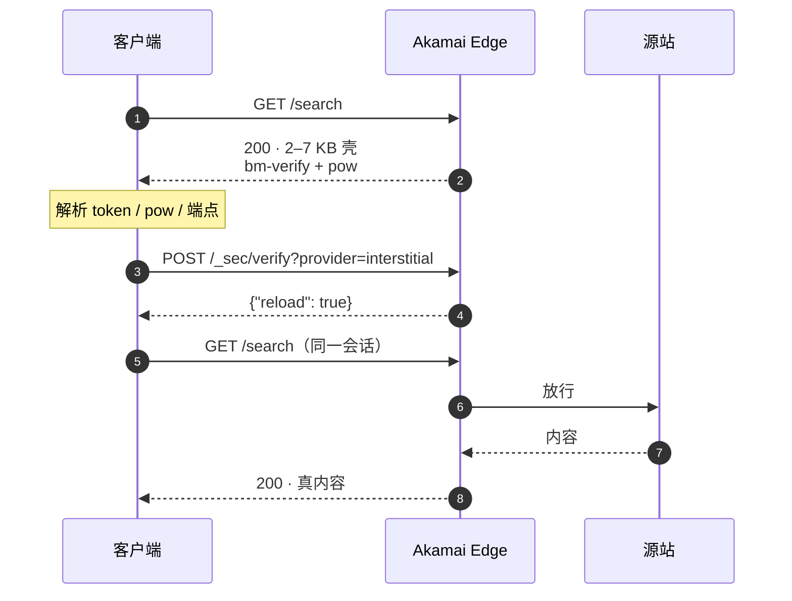

<div align="center">

# gatekit

**Akamai interstitial 挑战的探测 / 分析 / 求解工具包**

<sub>Detect, analyze, and solve Akamai interstitial challenges — with offline-tested judgments.</sub>

<sub>判据全部可离线回归 · 过闸与拿到内容分开计数 · 不把别家 WAF 算成失败</sub>


[快速开始](#快速开始) · [目录地图](#目录地图) · [能力边界](#能力边界) · [结果怎么读](#结果怎么读) · [文档](#文档)

</div>

---

> **它只解一道闸。** Akamai 的拦截方式很多，本项目只处理 **interstitial**——
> 那个 HTTP 200、2–7 KB、带一次性 `bm-verify` 令牌的壳。
> classic sensor、reCAPTCHA / PoW 挑战、PX / Cloudflare / DataDome / AWS WAF
> 都只识别、不求解，也不计入通过率。

## 30 秒看懂

| 你想知道 | 跑这个 | 看什么 |
|---|---|---|
| 这站拦不拦？拦在哪一层？ | `python -m gatekit probe URL` | `sensor` / `locked` / `challenge` |
| 闸能不能开？ | `python -m gatekit solve URL` | `solved` / `variant` / `trace` |
| 开了闸拿不拿得到数据？ | `python -m gatekit fetch URL -o page.html` | `gate.ok` + 正文体积 |
| 一批站到底过了多少？ | `python -m gatekit inventory --sweep ...` | `gate N/N` 与内容数**分开** |

最常见的三个误判：**响应慢当成没闸**、**过了闸当成拿到数据**、
**解不开当成求解器坏了**。对应排障见 [docs/PLAYBOOK.md](docs/PLAYBOOK.md)。

## 它解决的是什么



关键点只有三句话：

- **壳和内容都是 200**，状态码不参与判断，只看正文；
- **`pow` 不是哈希难题**，是两段数字先拼字符串、再相加；
- **闸开没开，和源站有没有内容，是两件事**。

逐包细节见 [docs/SITE_FLOW.md](docs/SITE_FLOW.md)。

## 快速开始

```bash
git clone https://github.com/jimmy-Smile-ltl/eg_akamai.git
cd eg_akamai
pip install -e .            # 唯一运行时依赖：curl_cffi

python -m gatekit probe   https://www.zara.com/
python -m gatekit solve   https://www.zara.com/
python -m gatekit fetch   https://www.flaticon.com/ -o page.html
python -m gatekit inventory --sweep examples/sample_sweep.json
```

Windows 下若 `python` 指向坏的解释器（例如残留的 Anaconda），把命令换成
`py -3.12 -m gatekit ...`。

也可以当库用：

```python
from gatekit import detect, solve
from gatekit.client import InterstitialClient
from gatekit import judges

info = detect("https://www.zara.com/")
print(info["sensor"], info.get("challenge"))

res = solve("https://www.zara.com/")
print(res["solved"], res.get("detail", {}).get("variant"))

c = InterstitialClient("https://www.nh-hotels.com")
print(c.unlock("/"))                       # {"ok": True, "variant": "..."}
status, html = c.get("/en/")

print(judges.is_interstitial(html))        # False
print(judges.content_like(html))           # True
```

## 目录地图

```text
eg_akamai/
├── gatekit/                  # 可安装的 Python 包（判据 / 求解 / 会话 / 口径）
├── docs/                     # 方法论文档（4 篇，按问题读）
├── data/fixtures/            # 10 份脱敏夹具（7 真实 + 3 构造）
├── examples/                 # 24 行真实样本账本
├── datasets/                 # akamai.com 公开客户清单 + 采集/检测脚本
└── tests/                    # 30 条离线断言（不联网）
```

| 目录 | 作用 | 先看这里 | 发布？ |
|---|---|---|---|
| [`gatekit/`](gatekit/README.md) | 库与 CLI。四层：判据、求解、会话、口径 | `judges.py`（纯函数，零依赖） | ✅ |
| [`docs/`](docs/README.md) | 方法论文档：怎么探测、链路长什么样、边界在哪、参数怎么用 | [PLAYBOOK](docs/PLAYBOOK.md) | ✅ |
| [`data/fixtures/`](data/README.md) | 脱敏后的真实/构造响应，只用于离线判据测试 | [MANIFEST](data/fixtures/MANIFEST.md) | ✅ 仅夹具 |
| [`examples/`](examples/README.md) | 24 行真实 sweep 摘录，覆盖五种桶，可复现根 README 的数字 | [README](examples/README.md) | ✅ |
| [`datasets/`](datasets/README.md) | akamai.com 官网公开客户案例（304 条 / 268 主机）及采集脚本 | [README](datasets/akamai_customers/README.md) | ✅ 仅元数据 |
| [`tests/`](tests/README.md) | 30 条离线断言，钉住判据与五桶分母 | `test_offline.py` | ✅ |

仓库里**没有**全量扫描语料、扫描得到的站点清单、有效 cookie / token。
它们生成在本地 `data/` 下并被 `.gitignore` 排除，原因见
[docs/BOUNDARIES.md](docs/BOUNDARIES.md) 第 6 节。

## 能力边界

| 能力 | 状态 | 说明 |
|---|:---:|---|
| 识别并解析 interstitial 壳 | ✅ | `is_interstitial` / `parse_interstitial` |
| standard POST 协议 | ✅ | `/_sec/verify?provider=interstitial` |
| A0 / A / B / canonical / cross-origin 变体 | ✅ | 兜底顺序固定，见 PLAYBOOK §3.2 |
| 过闸后同会话取页面 | ✅ | `InterstitialClient`，重锁自动再解 |
| 五桶口径、快照与隔轮 diff | ✅ | `inventory` |
| classic sensor / JS 环境 | ❌ | 明确不支持 |
| reCAPTCHA / crypto PoW | 👀 | 只识别、报告，不解 |
| PX / Cloudflare / DataDome / AWS WAF | 👀 | 识别为"别家"，不参与分母 |
| 登录 / 付费墙 / 人机验证 | ❌ | 不在范围 |

完整清单与已知启发式缺陷见 [docs/BOUNDARIES.md](docs/BOUNDARIES.md)。

## 结果怎么读

仓库自带一份 24 行真实 sweep 摘录（[`examples/sample_sweep.json`](examples/sample_sweep.json)），
不是构造数据，也没有剔除失败行：

```text
[sweep] examples/sample_sweep.json
  gated hosts 24: Akamai-native 20 / front AWS WAF 2 / DNS flip 2
  Akamai-native 20 -> content PASS 17 / gate-only 3 / fail 0
  gate 20/20 = 100.0%   content 17/20 = 85.0%
```

| 数字 | 含义 | **不要**读成 |
|---|---|---|
| 24 | 摘录行数 | "全网只有 24 个站" |
| 20 | Akamai-native（分母） | 分母之外还有 2 个 AWS WAF、2 个 DNS 摆动 |
| 100% 过闸 | 20 个站全部开了闸 | "20 个站都有内容" |
| 85% 有内容 | 17/20 | 另外 3 个是源站 401 / 503 / 短通告（`GATE-ONLY`） |

五桶定义与分母算法见 [PLAYBOOK §2.5](docs/PLAYBOOK.md)，逐行解读见
[`examples/README.md`](examples/README.md)。

## 文档

| 文档 | 回答的问题 |
|---|---|
| [PLAYBOOK](docs/PLAYBOOK.md) | **探测 → 分析 → 解决**：拿到一个新域名，按什么顺序做决定 |
| [SITE_FLOW](docs/SITE_FLOW.md) | **请求链路**：壳里有什么、每个包长什么样、变体怎么分叉 |
| [BOUNDARIES](docs/BOUNDARIES.md) | 支持范围、失败模式、已知缺陷、合规与数据政策 |
| [TOOLS](docs/TOOLS.md) | CLI 参数、Python API、输出字段、退出码 |

文档索引与推荐阅读顺序见 [`docs/README.md`](docs/README.md)。

## 研究规模（公开仓库之外）

<details>
<summary><b>展开：本地语料口径</b>（这些数据不随仓库发布）</summary>

判据和变体的结论来自一个更大的本地语料，**2026-11-01 快照，按主机名去重**
（注册域用 `tldextract` 归并，如 `www.zara.it` → `zara.it`）：

| 口径 | 主机 | 注册域 | 说明 |
|---|---:|---:|---|
| 第三方发现池（本地，不发布） | — | 2,821,720 | Majestic / Tranco / ccTLD / Umbrella 并集；只做 DNS / CNAME 发现，未逐站请求 |
| 首页扫描 | 39,796 | 36,309 | 45,590 行探测记录 |
| 深链 / 路由级 | 3,998 | 3,951 | 每台主机多条路径 |
| 首页 + 深链对照 | 21,484 | 20,267 | 同一个站分别看首页和深链 |
| Bot Manager 矩阵 | 1,808 | 1,694 | 检查 `_abck` / `bm_*` |
| DNS 侧普查 | 13,071 | 13,026 | CNAME / NS / 厂商 |
| **HTTP 探测去重** | **45,446** | **41,562** | 上面各轮实验的并集 |
| **全部 JSON 去重** | **55,341** | **51,446** | 含 DNS |
| 确认 Akamai 信号 | 3,552 | 3,229 | 首页扫描中出现 `akamai_page` 或 `/akam/` 标记 |
| 确认 interstitial 壳 | 107 | 95 | `interstitial=true` 或 `bm-verify` 标记 |
| 其中闸证据并集 | 296 | 275 | `interstitial` / `bm-verify` / `gated` / `gate=passed` 的并集 |
| 求解 / 内容成功 | 177 | 149 | 求解器判定 `ok=true` |

本地语料约 3 GB：217 个 JSON（97,039 行）、550 份 HTML 快照、233 份 PDF。
**这些数据不随仓库发布**：`.gitignore` 排除 `data/full/`、`data/corpus_sweep*.json`
以及所有 cookie / HAR / session 文件；仓库里只有脱敏后的固定夹具。

读这张表要注意：第三方池的 282 万只是 DNS 发现名单，不等于逐站发过请求；
各行之间也不互斥（同一台主机可能既在首页扫描里，也在深链实验里），所以只有
标为**去重**的两行是并集。公开的官网客户清单（268 主机）不在这张表里，它是
akamai.com 自己列出的案例，见 [`datasets/akamai_customers/`](datasets/akamai_customers/README.md)。

</details>

## 公开的官网客户清单

另一类和扫描语料分开的数据：`datasets/akamai_customers/` 从 akamai.com 的
公开 customer story 页提取客户索引（2026-09-17 快照）。

- **304** 条案例、**273** 条带客户网址、**268** 个去重主机；
- 只含标题、行业、地点、公开网址等元数据，**不含正文、PDF、图片**；
- 31 条案例没有外部客户链接；5 个主机对应两条案例；
- 采集脚本 `collect.py`、检测脚本 `check_akamai.py` 一并开源。

它回答的是「**官网公开列过谁**」，不是「现在谁还在用 Akamai」——2026-09-17
的首页级检测里，273 条网址只有 100 条还能看到 Akamai 信号。也不是本地那份
282 万的第三方候选池。字段、口径和复现方式见
[datasets/akamai_customers/README.md](datasets/akamai_customers/README.md)。

## 数据与合规

这个仓库是**协议研究与互操作性工具**，只发事实性元数据与脱敏夹具：

- ✅ 公开页面、公开元数据、已过期的挑战样本；
- ❌ 有效 cookie / token、个人数据、账号、目标站私有接口；
- ❌ 绕过登录、付费墙、验证码或访问控制；
- ❌ 对目标站施压（并发保持个位数，遇到 403 就退）。

默认**直连**，不内置代理池，也不需要住宅 IP。法律风险由使用者承担；
不同司法辖区对"绕过技术措施"的规定不同（中国《刑法》第 285 条第 3 款、
《网络安全法》第 27 条；美国 CFAA；欧盟成员国相关 implementation）。
**先确认你有权限，再发请求。** 详见 [BOUNDARIES §5](docs/BOUNDARIES.md)。

本项目与 Akamai Technologies 无关联，未获其授权或背书。Akamai 随时可能改变
挑战形态；本仓库按"当前观测到的形态"实现，不承诺长期有效。

## 参与

- 发现新形态 / 判据误判：先读 [CONTRIBUTING.md](CONTRIBUTING.md)，附一段能
  离线复现的 body；
- 安全问题（凭据落盘、请求打错域、夹具泄漏）：按 [SECURITY.md](SECURITY.md)
  走私密渠道，**不要**开公开 issue 贴有效 token。

## License

[MIT](LICENSE) © 2026 JimmySmile
